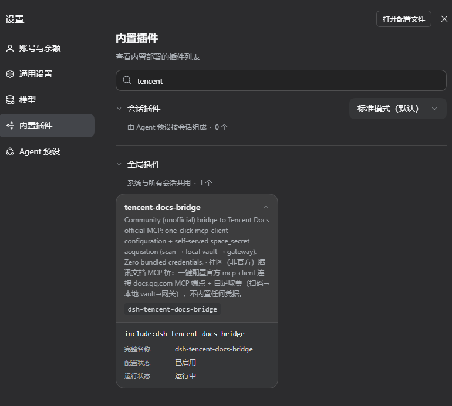

# DSH Plugin 市场提交材料（dsh-plugin.org/zh/submit）

> 本项目是 `hs666-ai` 的公开仓库 `dsh-tencent-docs-bridge`；本文档已填好所有上下文字段，
> 无需再替换用户名。按「提交三步」执行即可。

---

## 提交三步（对官方流程的操作化）

1. **发布公开仓库**
   - 在 GitHub 新建公开仓库 `dsh-tencent-docs-bridge`（命名随意，建议与包名一致）
   - 仓库描述写：`Unofficial DSH plugin bridging Tencent Docs official MCP endpoint (docs.qq.com) · 腾讯文档官方 MCP 桥（社区非官方）`
   - 把本目录（`dsh-tencent-docs-bridge` 项目根）文件推上去
2. **添加 topic**
   - 仓库页 → Settings/About → Topics → 输入 `dsh-plugin` → Save
3. **记录信任信号**
   - ✅ 安装命令（README 已有）
   - ✅ 支持的 profile（`web` 等任意 profile，README 已注明）
   - ✅ 许可证（MIT，README 徽章 + LICENSE 文件）
   - ✅ 权限/外部服务/兼容性（README ⚠️ 声明 + COMPLIANCE.md + DISCLAIMER.md）
   - ✅ 真实装机验证输出（README「本地验证记录」表）
   - ⬜ 截图（可选）：可在插件安装后截一张 DSH 工具列表含 `mcp__tencent-docs__*` 的图，替换下方 `# 仓库地址` 里的截图占位

---

## 收录要求逐条自查（提交 Issue 前必须全部勾选）

- [x] 仓库为**公开**仓库（推 GitHub 时：公开，勿选 Private）
- [x] 仓库已添加 GitHub topic：**dsh-plugin**
- [x] README 包含**安装命令**（形如 `dsh plugin --profile web add github:...`）——
      见 README「快速开始 → 安装插件」
- [x] 插件导出 **apply(ctx) 模块**——`lib/index.js` 导出 `name` + `apply`（官方规范）
- [x] 仓库根目录包含 **package.json**（写明了包名 `dsh-tencent-docs-bridge` 与版本 `0.2.1`）
- [x] 不冒充官方（README/DISCLAIMER/COMPLIANCE 多处声明社区非官方、无隶属）

> 常见被驳回原因对照：
> 仓库非公开 / 缺 dsh-plugin topic / 根缺 package.json / README 缺安装命令 / 未导出 apply(ctx)。
> 本插件五项全部满足。

---

## 提交 Issue 模板（复制到剪贴板，去 GitHub 发起）

> 官方入口：https://github.com/dshplugin/dsh-plugin-hub/issues/new
> 用下方模板填写。需要截图时，先在 README 或 Issue 里附上。

```markdown
### 仓库地址
https://github.com/hs666-ai/dsh-tencent-docs-bridge

### 一句话价值
安装后，DSH 里的 AI 能直接读写你的腾讯文档（表格/文档/幻灯片），底层走腾讯文档官方 MCP 端点，无需第三方中转；插件同时提供完全自足的取票链路（扫码 → 本地 vault → 动态挂载），仓库零内嵌凭据。

### 能力分类
集成与连接

### 安装命令
dsh plugin --profile web add @hs666-ai/dsh-tencent-docs-bridge
（或从 GitHub 源码安装：`dsh plugin --profile web add github:hs666-ai/dsh-tencent-docs-bridge`）
> 两条命令都不锁版本，安装时取 npm `latest` / GitHub `main` 的最新发布（当前 0.2.1）。

### 兼容与运行要求
- DSH：实测通过 v0.2.0-rc.2（真实装机验证：plugin add → 合成树 → 入口加载 → host boot 均无报错）
- Node.js ≥ 22.6
- 平台：Windows（实测）；macOS/Linux 预期可用
- 运行环境：本地执行，需用户自备腾讯文档登录态（QQ/微信）获取 space_secret

### 许可证
MIT

### 截图 / 演示


真实装机截图：插件在 desktop profile 的 DSH「内置插件」面板中**已启用、运行中**
（DeepSeek Harness v0.2.0-rc.2 实测）。README 另有装机验证记录表。

### 补充说明
- 非官方社区项目，无腾讯/DeepSeek 隶属关系
- 凭据安全：space_secret 仅存本地 vault（0600/ACL 收紧）或环境变量，日志只出脱敏指纹（len32: 前4位）
- 外部服务：直连腾讯文档官方 MCP（https://docs.qq.com/openapi/mcp），遵守官方频率限制（免费 2000 次/天），不绕过
- 已知限制：个人版账号能力范围以官方 MCP 为准；需 Node ≥ 22.6

### 提交前自查
- [x] 仓库已公开
- [x] 已添加 GitHub topic：dsh-plugin
- [x] README 包含安装命令
- [x] 插件导出 apply(ctx) 模块
- [x] 仓库根目录包含 package.json
```

---

## 收录状态与徽章

**已收录**（2026-10-19 实测 HTTP 200）：
[dsh-plugin.org/plugins/hs666-ai/dsh-tencent-docs-bridge](https://dsh-plugin.org/plugins/hs666-ai/dsh-tencent-docs-bridge)

该详情页由市场自动生成/重写 README，安装命令不锁版本（取 GitHub `main` 最新），
故发布 0.2.1 后无需在市场侧改「安装说明」，市场下次扫描会自动同步。

如需在 README 加收录徽章（可选）：

```markdown
[](https://dsh-plugin.org/plugins/hs666-ai/dsh-tencent-docs-bridge)
```

---

## 提交漏斗：三处一次做对，直接进「已确认」

| 步骤 | 在哪做 | 做什么 |
|---|---|---|
| 推码 | GitHub | 公开仓库 + 仓库描述 + README |
| 打标 | GitHub repo About | Topics 加 `dsh-plugin` |
| 申报 | dsh-plugin-hub Issues | 用上文模板开 Issue（社区会扫描/收录） |